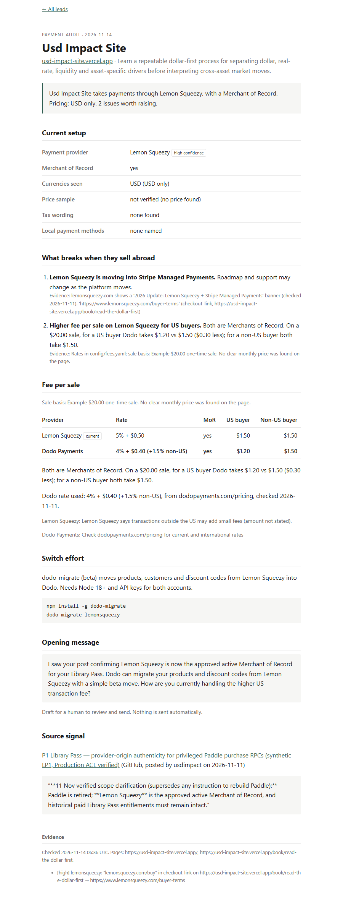
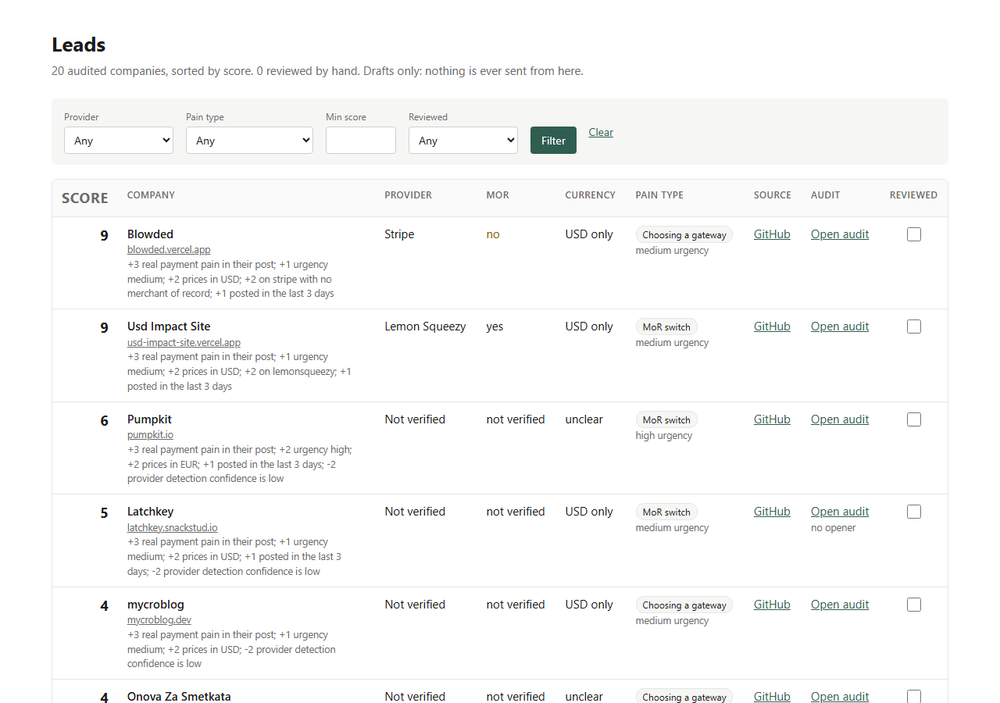

# Dodo Lead Audit

## What this is (for the Dodo team)

1. It reads public Hacker News and GitHub posts where small software teams talk about payment trouble: Stripe is not available in their country, a payment provider rejected them, they have tax worries, or they are picking a merchant of record.
2. It opens each team's public website and works out which payment provider they use, whether they have a merchant of record, and what currencies they charge in.
3. It scores every company from 0 to 10 for fit with Dodo Payments. You can see why each company got its score.
4. It writes a one page audit for each top lead: their provider, what breaks when they sell abroad, the fee math, how hard switching would be, and a short opener someone can send.
5. It only reads and drafts. It never sends, posts or signs up for anything. A person reviews every lead and sends every message. If something can't be confirmed, the audit says "not verified".





## Setup

You need Python 3.11 or newer. Commands are for Windows PowerShell. On macOS or Linux, use `source .venv/bin/activate` instead.

```powershell
python -m venv .venv
.venv\Scripts\Activate.ps1
pip install -e ".[dev]"
playwright install chromium
copy .env.example .env
```

Then fill in `.env`:

| Setting | What it is |
|---|---|
| `GROQ_API_KEY` | Required. Free key from console.groq.com. |
| `LLM_MODEL` | Model used to classify posts. `openai/gpt-oss-20b` is fine. |
| `LLM_OPENER_MODEL` | Optional, stronger model for the openers only, for example `openai/gpt-oss-120b`. Empty means use `LLM_MODEL`. |
| `CONTACT_EMAIL` | Put in the user agent so site owners can reach you. |
| `GITHUB_TOKEN` | Optional. Raises the GitHub search limit from 10 to 30 a minute. A token with no scopes is enough. |
| `INR_PER_USD` | Exchange rate used in the fee math. |
| `REQUEST_DELAY_SECONDS` | Wait between requests to the same site. Keep it at 3 or more. |

`.env` is in `.gitignore`. Never commit it.

Check the install:

```powershell
pytest
```

## Use

```powershell
python cli.py run --days 7 --top 20   # find, score and audit the top 20 leads
python cli.py serve                   # dashboard at http://127.0.0.1:8000
```

`run` makes one pass over the last `--days` days and then stops. Run it again whenever you want fresh leads. One run every day or two with `--days 3` works well.

- Posts are stored once and keyed by their URL, so a re-run only classifies new posts.
- Site pages are cached for 24 hours.
- "Reviewed" ticks survive a re-run for companies still in the top N. A company that drops out of the top N has its audit removed.

Output:

- `output/leads.csv`: the ranked leads.
- `output/audits/*.html`: one audit per lead. Each is a standalone file you can open or share.
- `output/leads.db`: SQLite database with posts, companies, audits and reviewed ticks.

The dashboard has a **Run** button that does the same thing as `python cli.py run`. You can set the days and the top N. It shows the run's log as it happens and reloads the list when it finishes. Only one run can go at a time. Untick "Fetch new posts" to re-score what is already stored without fetching anything new.

The dashboard lists leads by score, filters by provider, pain type, minimum score and reviewed state, opens each audit, and saves the "Mark reviewed" ticks to the database.

Other commands:

```powershell
python cli.py audit https://example.com        # audit one site by hand
python cli.py audit-file urls.txt              # audit a list of sites, one url per line
python cli.py listen --days 7                  # only fetch and classify posts
python cli.py classify                         # finish classifying posts left pending
python cli.py signals --sample --limit 20      # export a mix of posts to check the classifier
```

Add `--no-opener` to `run` or `audit` to skip the LLM opener.

## Score

| Points | Rule |
|---|---|
| +3 | The post shows real payment pain |
| +2 / +1 | High or medium urgency |
| +2 | Their site shows USD, EUR or GBP prices |
| +2 | They use Stripe, Razorpay, Cashfree, PayU, Juspay or PayPal with no merchant of record |
| +2 | They use Lemon Squeezy or Paddle (they already chose a merchant of record, so they can switch) |
| +1 | INR-only pricing, and the post talks about selling abroad |
| +1 | Posted in the last 3 days |
| -2 | Low confidence in which provider they use |
| 0 | They already use Dodo Payments, or their post mentions Dodo |

The total is kept between 0 and 10. The reasons appear on the dashboard and in the CSV.

## Limits and rules

- **Free LLM tier:** Groq's free tier allows about 200,000 tokens a day per model. Classifying a few hundred posts can use up a day's quota. When that happens the tool stops cleanly, and the rest are finished by `python cli.py classify` the next day.
- **Missing sites:** many pain posts don't link to a product site. Those can't be audited and are counted as "without product url" in the run summary.
- **Polite fetching:** the tool follows robots.txt, waits at least 3 seconds between requests to the same site, and identifies itself as `DodoLeadAudit/0.1 (research; contact: <CONTACT_EMAIL>)`.
- **Public pages only:** it never logs in or submits forms.
- **Public data only:** it stores company URLs, public post links and public usernames. It stores no emails or phone numbers.
- **Unconfirmed facts:** anything it can't confirm is marked "not verified". Check the evidence section at the bottom of each audit before sending an opener.
- **Memory:** Chromium needs a few hundred MB of free memory. If a run crashes with "Target crashed", close some browser tabs and run it again.
