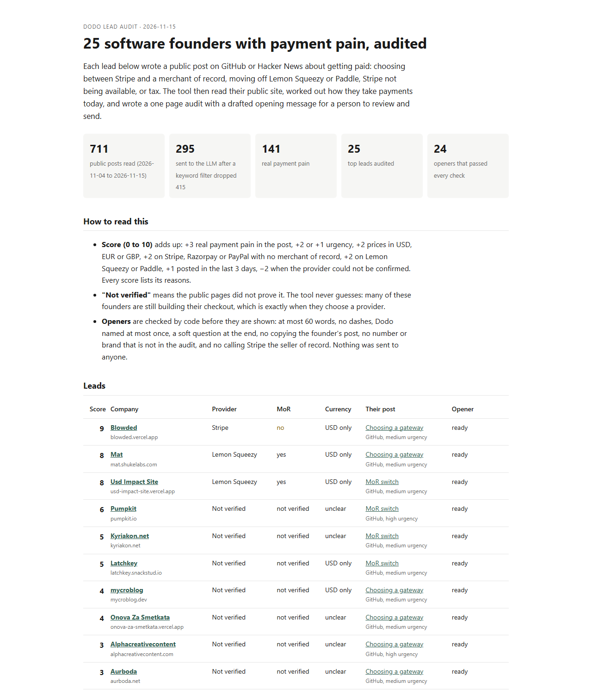

# Dodo Lead Audit

A lead engine for [Dodo Payments](https://dodopayments.com). It finds software founders who are posting publicly about getting paid, checks how their product takes payments today, and writes a one page payment audit with a drafted opening message for a person to send.

Built by Mohammed Zaid as a working answer to the question: *where do Dodo's next customers announce themselves, and what would you say to them?*



## The problem

Founders choosing a payment setup rarely search for "merchant of record". They post things like *"Stripe isn't available in India, what do I use?"*, *"Moving off Lemon Squeezy"*, or *"Spec: Stripe payments, Stripe is the seller of record"* (it isn't). Those posts are the best buying signal there is, and they are spread across thousands of GitHub issues and Hacker News threads.

## What it does

1. **Listens.** Pulls recent public GitHub issues and Hacker News posts that mention payment providers, merchant of record, tax or selling abroad.
2. **Filters, then classifies.** A keyword pre-filter drops obvious noise for free, then an LLM labels the rest: is this real payment pain, what kind (choosing a gateway, MoR switch, Stripe access, tax), and how urgent.
3. **Finds the product.** Uses the link in the post, else the repo homepage, else a link in the README that is clearly the product site.
4. **Reads their site.** Loads the public pages in a headless browser and detects the payment provider from scripts, checkout links and network calls, plus pricing currencies, tax wording and local payment methods.
5. **Scores 0 to 10**, and every score lists its reasons.
6. **Writes the audit:** current setup, what breaks when they sell abroad, fee per sale against Dodo and a reference MoR, switch effort, and a drafted opener. Each issue shows the evidence it rests on.

Everything is browsable in a local dashboard, or exported as one self-contained HTML report.

## Results from the first week

| Step | Count |
|---|---|
| Public posts read (4 to 15 Nov 2026) | 711 |
| Dropped by the keyword pre-filter, at no LLM cost | 415 |
| Classified by the LLM | 295 |
| Real payment pain | 141 |
| Distinct product sites found (latest run) | 33 |
| Top leads audited (latest run) | 25 |
| Openers that passed every automated check | 24 |

The strongest leads: a WhatsApp ordering app on Stripe with no merchant of record, charging in USD; two products already on Lemon Squeezy whose founders are rethinking their payment setup; and several founders mid-way through choosing a provider. The one opener that failed was for a founder whose own spec says "Stripe is the seller of record". The checks refused to let the model repeat that, so it is marked "write by hand", which is the right call.


## Design decisions

- **Never invent a fact.** If the public pages do not prove a provider or price, the audit says "not verified" and the score takes −2. A wrong claim in a sales message costs more than a missing one.
- **Check the LLM in code, do not just prompt it.** Every opener is tested before it is shown:
  - at most 60 words, no dashes, Dodo named at most once, ending on a soft question
  - no hard ask like "book a call"
  - no copying 7 or more words from the founder's post
  - no number, price or brand that is not in the audit
  - never calling Stripe or Razorpay the seller of record
  - never promising Dodo does something outside payments and tax

  A failed draft is rewritten up to twice with the broken rules fed back. Openers that still pass are kept across runs, so no tokens are spent redrafting good ones.
- **Get the domain right.** The audit explains the difference between a processor (Stripe: you stay the seller of record and own the tax) and a merchant of record (Dodo, Paddle, Lemon Squeezy: they are the seller and handle the tax), and the fee table shows both.
- **Spend tokens only where they matter.** The keyword pre-filter dropped 58% of posts before the LLM saw them. Rendered pages are cached. It runs within Groq's free tier, and stops cleanly at the daily limit and resumes the next day.
- **Prefer a miss to a wrong guess.** The README product-site lookup only accepts a link labelled as the site, or a domain named after the repo. On 65 real READMEs it found 9 sites, all correct. Earlier looser rules picked 6 wrong ones, which are now regression tests.
- **Be a good citizen.** It respects robots.txt and skips a site if robots.txt cannot be read. It waits 3 seconds between requests to the same site, sends an identifying user agent, and never logs in or submits a form. It stores only public post links, usernames and company URLs. Emails and phone numbers are stripped from post text.
- **A human sends everything.** The tool reads and drafts. Nothing is ever posted, replied to or emailed.

## Honest limits

- **Most providers are unconfirmed.** 22 of 25 audited sites show no live checkout yet. Many of these founders are still building it, which is exactly when they pick a provider, but it means those audits lean on the post more than on the site.
- **Many posts have no product site.** About half of the pain posts link no product site and cannot be audited.
- **GitHub dominates.** Hacker News search returned very few matching posts in this window.
- **The score weights are a first guess.** Reply rates from real outreach are what should tune them.

## What I would do next at Dodo

- Tune the score with real outcomes: which leads replied, signed up, went live.
- Add sources where Dodo's buyers talk, such as Indie Hackers, X and Discord communities, within each platform's rules.
- Push reviewed leads into the CRM instead of a CSV.
- Watch for posts mentioning a competitor's outage or a pricing change, which are the most urgent switch signals.

---

## Setup

You need Python 3.11 or newer. Commands are for Windows PowerShell. On macOS or Linux, use `source .venv/bin/activate` instead.

```powershell
python -m venv .venv
.venv\Scripts\Activate.ps1
pip install -e ".[dev]"
playwright install chromium
copy .env.example .env
```

Then fill in `.env`:

| Setting | What it is |
|---|---|
| `GROQ_API_KEY` | Required. Free key from console.groq.com. |
| `LLM_MODEL` | Model used to classify posts. `openai/gpt-oss-20b` is fine. |
| `LLM_OPENER_MODEL` | Optional, stronger model for the openers only, for example `openai/gpt-oss-120b`. Empty means use `LLM_MODEL`. |
| `CONTACT_EMAIL` | Put in the user agent so site owners can reach you. |
| `GITHUB_TOKEN` | Optional. Raises the GitHub search limit from 10 to 30 a minute. A token with no scopes is enough. |
| `INR_PER_USD` | Exchange rate used in the fee math. |
| `REQUEST_DELAY_SECONDS` | Wait between requests to the same site. Keep it at 3 or more. |

`.env` is in `.gitignore`. Never commit it.

Check the install with `pytest`.

## Use

```powershell
python cli.py run --days 7 --top 20   # find, score and audit the top 20 leads
python cli.py serve                   # dashboard at http://127.0.0.1:8000
python cli.py report                  # one HTML file with every lead and audit
python cli.py redraft                 # redo only the openers that failed their checks
```

`run` makes one pass over the last `--days` days and then stops. Run it again for fresh leads; one run every day or two with `--days 3` works well.

- **Re-runs are cheap.** Posts are stored once, keyed by URL, so a re-run only classifies new ones. Site pages are cached for 24 hours, and openers that still pass are kept.
- **Reviewed ticks are kept** for companies still in the top N. A company that drops out of the top N has its audit removed.

The dashboard:
- lists leads by score, with filters for provider, pain type, minimum score and reviewed state
- opens each audit and saves "Mark reviewed" ticks to the database
- has a **Run** button that does the same as `python cli.py run`, with a live log

Output:

- `output/report.html`: one self-contained file with the ranked leads and every audit, to send to someone.
- `output/leads.csv`: the ranked leads.
- `output/audits/*.html`: one standalone audit per lead.
- `output/leads.db`: SQLite database with posts, companies, audits and reviewed ticks.

Other commands:

```powershell
python cli.py audit https://example.com        # audit one site by hand
python cli.py audit-file urls.txt              # audit a list of sites, one url per line
python cli.py listen --days 7                  # only fetch and classify posts
python cli.py classify                         # finish classifying posts left pending
python cli.py signals --sample --limit 20      # export a mix of posts to check the classifier
```

Add `--no-opener` to `run` or `audit` to skip the LLM opener.

## Score

| Points | Rule |
|---|---|
| +3 | The post shows real payment pain |
| +2 / +1 | High or medium urgency |
| +2 | Their site shows USD, EUR or GBP prices |
| +2 | They use Stripe, Razorpay, Cashfree, PayU, Juspay or PayPal with no merchant of record |
| +2 | They use Lemon Squeezy or Paddle (they already chose a merchant of record, so they can switch) |
| +1 | INR-only pricing, and the post talks about selling abroad |
| +1 | Posted in the last 3 days |
| −2 | Low confidence in which provider they use |
| 0 | They already use Dodo Payments, or their post mentions Dodo |

The total is kept between 0 and 10.

## Operating notes

- **Free LLM tier:** Groq's free tier allows about 200,000 tokens a day per model. When the limit is hit the run stops cleanly, and `python cli.py classify` finishes the rest the next day.
- **Memory:** Chromium needs a few hundred MB free. If a run crashes with "Target crashed", close some browser tabs and run it again.
